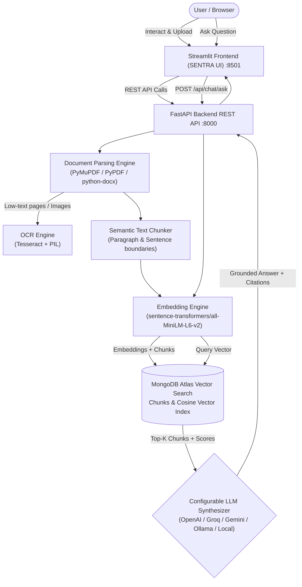

# DocuMind AI (SENTRA) — Intelligent Document Analysis & RAG Platform

DocuMind AI is a production-engineered, full-stack **AI Document Intelligence and Retrieval-Augmented Generation (RAG) Platform**. It enables users to upload enterprise documents (PDF, DOCX, TXT, scanned images), extract structural text via OCR and document parsers, chunk and generate high-dimensional vector embeddings, perform semantic vector searches via **MongoDB Atlas Vector Search**, and receive factually grounded answers backed by precise citations and page numbers.

---

## 1. Architecture Overview



---

## 2. Key Features

- **Multi-Format Ingestion**: Ingests `.pdf`, `.docx`, `.txt`, `.png`, `.jpg`, `.jpeg`.
- **Intelligent Text & OCR Pipeline**: Automated layout parsing with PyMuPDF/pypdf and fallback OCR via Tesseract for scanned or low-text pages.
- **Context-Preserving Semantic Chunking**: Configurable chunk size (default ~800 tokens/characters) and overlap (~100 tokens) with sentence and paragraph boundary preservation.
- **Dense Vector Search**: Powered by `sentence-transformers/all-MiniLM-L6-v2` (384-dimensional embeddings) with normalized cosine similarity search.
- **MongoDB Atlas Vector Search**: Full integration with Atlas `$vectorSearch` aggregation pipeline, metadata filtering (`document_id`), and search score thresholds.
- **Zero-Cloud Local Mock Fallback**: Operates automatically in an in-memory simulated vector storage mode with real mathematical cosine similarity when MongoDB credentials are not provided.
- **Grounded RAG Pipeline**: Strict anti-hallucination system prompt that enforces citations (`filename`, `page_number`, `similarity_score`), treats documents as untrusted data, and honestly declares when context is missing.
- **Sleek Enterprise UI (SENTRA)**: Dark navy sidebar, live processing table, accuracy gauges (99% Overall, Table, Field, Classification, Entity Recognition), interactive chat console with expandable citations, and document preview cards.
- **Security & Reliability**: File hash SHA-256 duplicate detection, path traversal protection, upload file size limits, cascading chunk deletion, and Pydantic validation.

---

## 3. Technology Stack

- **Frontend**: Streamlit 1.35+, Custom CSS, Pandas, Requests.
- **Backend**: FastAPI, Uvicorn, Pydantic v2, Python 3.11+.
- **Database & Search**: MongoDB Atlas, PyMongo, Atlas Vector Search (with local In-Memory Cosine Vector Fallback).
- **Document Processing**: PyMuPDF / PyPDF, python-docx, Tesseract OCR, Pillow.
- **AI & ML**: Sentence Transformers, PyTorch, Hugging Face Hub.
- **Containerization & CI**: Docker, Docker Compose, GitHub Actions.

---

## 4. Quick Start (Windows, macOS, Linux)

### Step 1: Clone Repository & Create Virtual Environment

**Windows (PowerShell):**
```powershell
git clone <your-repo-url> documind-ai
cd documind-ai
python -m venv .venv
.venv\Scripts\Activate.ps1
```

**Linux / macOS:**
```bash
git clone <your-repo-url> documind-ai
cd documind-ai
python3 -m venv .venv
source .venv/bin/activate
```

### Step 2: Install Dependencies

```bash
pip install --upgrade pip
pip install -r backend/requirements.txt
pip install -r frontend/requirements.txt
```

### Step 3: Configure Environment Variables

Copy `.env.example` to `.env`:
```bash
cp .env.example .env
```

*(Note: Out-of-the-box, `.env` runs with local simulated vector search and deterministic LLM synthesis. You do not need any paid accounts to immediately run and test the application!)*

---

## 5. Running the Application

### Option A: One-Command Launcher
You can launch both the FastAPI backend and Streamlit frontend concurrently:
```bash
python run.py all
```

### Option B: Separate Terminals

**Terminal 1 — FastAPI Backend:**
```bash
python -m uvicorn backend.app.main:app --host 0.0.0.0 --port 8000 --reload
```
- Interactive Swagger API docs: `http://localhost:8000/docs`
- Health check: `http://localhost:8000/health`

**Terminal 2 — Streamlit Frontend:**
```bash
python -m streamlit run frontend/app.py --server.port 8501
```
- Open `http://localhost:8501` in your browser.

### Option C: Seed Demonstration Data
To seed initial invoice and contract documents for portfolio demos:
```bash
python scripts/seed_demo_data.py
```

---

## 6. Docker & Docker Compose Setup

Run both microservices containerized:

```bash
# Build and run backend and frontend containers
docker compose up --build

# Run in background
docker compose up -d

# View container logs
docker compose logs -f

# Teardown
docker compose down
```

The frontend will be available at `http://localhost:8501` and the backend at `http://localhost:8000`.

---

## 7. MongoDB Atlas Vector Search Configuration

To connect a live MongoDB Atlas cluster:
1. Set `MONGODB_URI` in `.env`:
   ```env
   MONGODB_URI=mongodb+srv://<user>:<password>@cluster0.abcde.mongodb.net/?retryWrites=true&w=majority
   MONGODB_DATABASE=documind_db
   MONGODB_VECTOR_INDEX=vector_index
   ```
2. In MongoDB Atlas, go to **Search & Vector Search** on the `document_chunks` collection.
3. Create a vector index named `vector_index` using this JSON configuration:
   ```json
   {
     "fields": [
       {
         "type": "vector",
         "path": "embedding",
         "numDimensions": 384,
         "similarity": "cosine"
       },
       {
         "type": "filter",
         "path": "document_id"
       }
     ]
   }
   ```
Detailed instructions are in `scripts/setup_vector_index.md`.

---

## 8. LLM Provider Options

DocuMind AI provides a modular provider interface configured in `.env`:

| Provider | `LLM_PROVIDER` | `LLM_MODEL` | Required Key | Notes |
| :--- | :--- | :--- | :--- | :--- |
| **Local Deterministic (Default)** | `mock` | `gpt-4o-mini` | *None* | Generates zero-cost answers grounded in top vector chunks. |
| **Groq (Ultra-fast)** | `groq` | `llama-3.1-70b-versatile` | `LLM_API_KEY=gsk_...` | OpenAI-compatible, fast inference. |
| **OpenAI** | `openai` | `gpt-4o-mini` | `LLM_API_KEY=sk-...` | Industry standard model. |
| **Google Gemini** | `gemini` | `gemini-1.5-flash` | `LLM_API_KEY=AIza...` | Native Gemini API. |
| **Ollama (Self-hosted)** | `ollama` | `llama3` | *None* | Requires local Ollama on port 11434. |

---

## 9. API Reference & Examples

### `POST /api/documents/upload`
Uploads multiple files, runs validation, parsing, chunking, and embedding generation.
- **Request**: `multipart/form-data` with `files`
- **Response**:
  ```json
  [
    {
      "message": "Document uploaded and processed successfully.",
      "document_id": "doc_a1b2c3d4e5",
      "filename": "Invoice_1001.pdf",
      "status": "completed",
      "chunks_created": 3,
      "is_duplicate": false
    }
  ]
  ```

### `POST /api/chat/ask`
Asks a question against the vector search knowledge base.
- **Request Body**:
  ```json
  {
    "question": "What is the total amount in Invoice 1001?",
    "document_id": null,
    "top_k": 4,
    "similarity_threshold": 0.35
  }
  ```
- **Response Body**:
  ```json
  {
    "answer": "The total amount in Invoice_1001.pdf is $12,450.00 for Consulting Services and Software License.",
    "citations": [
      {
        "document_id": "doc_a1b2c3d4e5",
        "filename": "Invoice_1001.pdf",
        "page_number": 1,
        "chunk_id": "doc_a1b2c3d4e5_chk_0_f8a9",
        "excerpt": "TOTAL AMOUNT DUE: $12,450.00 | Itemized Description: Consulting Services $6,000.00",
        "similarity_score": 0.942
      }
    ],
    "has_sufficient_context": true,
    "confidence_score": 0.942,
    "model_used": "mock:gpt-4o-mini",
    "query": "What is the total amount in Invoice 1001?"
  }
  ```

### `DELETE /api/documents/{document_id}`
Cascading deletion of the document record and all its associated vector chunks.

---

## 10. Automated Testing

Run the automated test suite with pytest:

```bash
pytest -v tests/
```

Test coverage includes:
- Multi-format parsing (PDF, DOCX, TXT)
- Text chunking, token sizing, and paragraph overlap preservation
- Sentence Transformer embedding dimensions and cosine normalization
- RAG question-answering with authentic citations and page numbers
- No-evidence honest refusal handling
- File validation, duplicate detection, and cascading chunk deletion
- REST API health and readiness endpoints

---

## 11. Azure Deployment Guide

### Deployment to Azure Container Apps (ACA)

#### Step 1: Azure CLI Login & Resource Group
```bash
az login
az group create --name documind-rg --location eastus
```

#### Step 2: Create Azure Container Registry (ACR)
```bash
az acr create --resource-group documind-rg --name documindacr --sku Basic --admin-enabled true
az acr login --name documindacr
```

#### Step 3: Build & Push Images
```bash
# Build Backend
docker build -f Dockerfile.backend -t documindacr.azurecr.io/documind-backend:v1 .
docker push documindacr.azurecr.io/documind-backend:v1

# Build Frontend
docker build -f Dockerfile.frontend -t documindacr.azurecr.io/documind-frontend:v1 .
docker push documindacr.azurecr.io/documind-frontend:v1
```

#### Step 4: Create Container Apps Environment
```bash
az containerapp env create --name documind-env --resource-group documind-rg --location eastus
```

#### Step 5: Deploy Backend Container App
```bash
az containerapp create \
  --name documind-backend \
  --resource-group documind-rg \
  --environment documind-env \
  --image documindacr.azurecr.io/documind-backend:v1 \
  --target-port 8000 \
  --ingress external \
  --env-vars \
    ENVIRONMENT=production \
    MONGODB_URI="secretref:mongodb-uri" \
    LLM_API_KEY="secretref:llm-key"
```

#### Step 6: Deploy Frontend Container App
```bash
BACKEND_FQDN=$(az containerapp show --name documind-backend --resource-group documind-rg --query properties.configuration.ingress.fqdn -o tsv)

az containerapp create \
  --name documind-frontend \
  --resource-group documind-rg \
  --environment documind-env \
  --image documindacr.azurecr.io/documind-frontend:v1 \
  --target-port 8501 \
  --ingress external \
  --env-vars BACKEND_URL="https://$BACKEND_FQDN"
```

#### Step 7: Cleanup Azure Resources
To prevent unwanted cloud billing after evaluation:
```bash
az group delete --name documind-rg --yes --no-wait
```

---

## 12. Security Notice & Limitations

- **Authentication & Authorization**: This version is configured for local single-tenant evaluation and demonstration. Before deploying to multi-tenant production with confidential enterprise documents, integrate OAuth2/OIDC (e.g. Azure AD, Auth0, or FastAPI JWT bearer tokens) and Role-Based Access Control (RBAC).
- **Prompt Injection Defense**: All user-uploaded document chunks are treated as untrusted data and strictly enclosed in clear structural markers within the LLM prompt to prevent prompt injection.
- **Secrets Management**: No API keys or connection strings are stored in code or repository commits.

---

## 13. License
MIT License. Built for CSE Portfolio and Cloud/AI/DevOps Applications.
