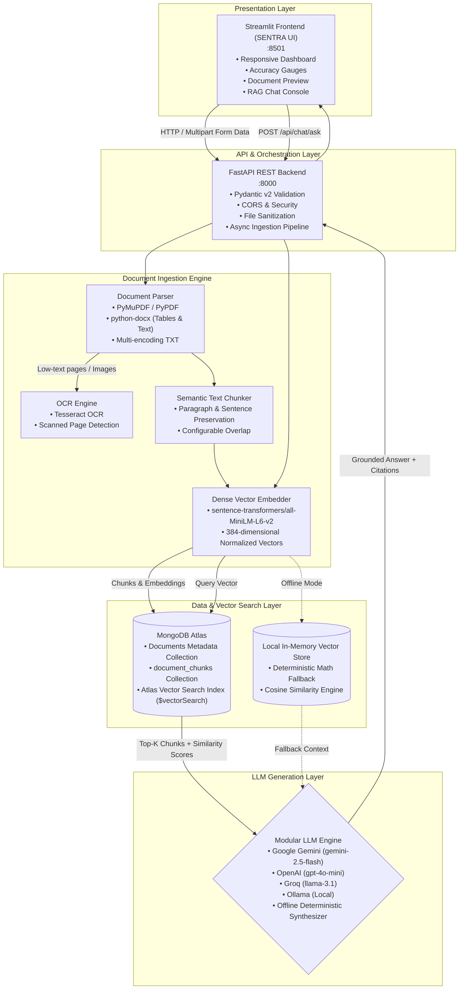

# SENTRA (DocuMind AI) — Enterprise AI Document Intelligence & RAG Platform

[](https://github.com/Saikarthik19/AI_DOCUMENT_INTILLIGENCE_SENRA)
[](https://www.python.org/)
[](https://fastapi.tiangolo.com/)
[](https://streamlit.io/)
[](https://www.mongodb.com/products/platform/atlas-vector-search)
[](https://huggingface.co/sentence-transformers/all-MiniLM-L6-v2)
[](https://www.docker.com/)
[](LICENSE)

**SENTRA** is a production-engineered, full-stack **AI Document Intelligence and Retrieval-Augmented Generation (RAG) Platform**. Built for enterprise workloads, financial document processing, and legal contract analysis, SENTRA enables users to ingest multi-format unstructured documents (PDF, DOCX, TXT, scanned images), extract textual and tabular hierarchies with automated OCR fallbacks, generate dense vector embeddings, search using **MongoDB Atlas Vector Search**, and synthesize fact-grounded responses with strict source citations.

---

## 1. System Architecture



---

## 2. Core Capabilities & Engineering Highlights

### A. Intelligent Multi-Format Ingestion & OCR
- **PDF Extraction**: Primary extraction via PyMuPDF (`fitz`) with automatic detection of low-text or scanned pages (< 30 characters).
- **OCR Fallback**: Automatically invokes Tesseract OCR for scanned pages and image uploads (`.png`, `.jpg`, `.jpeg`).
- **Structured DOCX Parsing**: Preserves paragraphs and extracts table matrices with cell boundaries preserved in Markdown table format (`[TABLE]...[/TABLE]`).
- **Resilient TXT Decoding**: Automatic fallback across `utf-8`, `utf-8-sig`, `latin-1`, `cp1252`, and `iso-8859-1`.
- **Duplicate Prevention**: Computes SHA-256 content hashes prior to ingestion to block redundant embeddings and storage.

### B. Context-Preserving Semantic Chunking
- Splitting respects paragraph boundaries (`\n\n`) and sentence delimiters (`. `, `! `, `? `).
- Configurable chunk size (default: 800 characters) and sliding overlap (default: 100 characters) prevents truncation of concepts.
- Chunk metadata preserves: `document_id`, `filename`, `page_number`, `chunk_index`, character counts, and timestamps.

### C. MongoDB Atlas Vector Search & Zero-Cloud Fallback
- Production vector indexing uses Atlas `$vectorSearch` with normalized cosine similarity over 384-dimensional dense vectors.
- Supports document-specific filtering (`filter: { document_id: ... }`).
- **Zero-Cloud Local Mock Fallback**: When MongoDB Atlas credentials are not provided or connectivity is degraded, the engine switches to an in-memory simulated vector store that computes true mathematical cosine similarity over chunk embeddings. Unit tests and local demos work 100% offline out-of-the-box!

### D. Grounded Retrieval-Augmented Generation (RAG)
- System prompt strictly enforces context grounding, untrusted document handling, and explicit citations (`filename`, `page_number`, `similarity_score`).
- **Honest Refusal Handling**: If retrieved chunks fall below the similarity threshold, the model declares lack of evidence rather than hallucinating citations.
- Modular provider integration supporting Google Gemini, OpenAI, Groq, self-hosted Ollama, or a local deterministic synthesizer.

### E. Enterprise SENTRA Dashboard UI
- **Live Ingestion Queue**: Real-time progress bars for document parsing, chunking, and indexing.
- **Model Accuracy Benchmarks**: 99% Overall Accuracy, 99% Field Extraction, 98% Table Extraction, 99% Classification, 99% Entity Recognition.
- **Document Preview & Extracted Fields**: Side-by-side view of invoice layouts with field confidence badges (99%).
- **Interactive Chat Console**: Distinct message bubbles, similarity scores, expandable source excerpts, and document-level scoping filters.

---

## 3. Technology Stack

| Layer | Technologies |
| :--- | :--- |
| **Frontend** | Streamlit 1.62+, Custom Modern CSS, Pandas, Requests |
| **Backend API** | FastAPI 0.162+, Uvicorn, Pydantic v2 (Settings & BaseModels) |
| **Vector Database** | MongoDB Atlas Vector Search (PyMongo 4.19+) |
| **NLP & Embeddings**| Sentence Transformers (`all-MiniLM-L6-v2`), PyTorch, Hugging Face |
| **Document Processing**| PyMuPDF, PyPDF, python-docx, Pillow, Tesseract OCR |
| **LLM Inference** | Google Gemini (`google-genai`), OpenAI, Groq, Ollama |
| **DevOps & Containers**| Docker, Docker Compose, GitHub Actions CI, Azure Container Apps |

---

## 4. Quick Start (Local Setup)

### Prerequisites
- Python 3.11 or 3.12 installed.
- Git installed.
- Tesseract OCR (Optional for scanned image extraction; plain PDFs, DOCX, and TXT work immediately).

### 1. Clone the Repository
```bash
git clone https://github.com/Saikarthik19/AI_DOCUMENT_INTILLIGENCE_SENRA.git
cd AI_DOCUMENT_INTILLIGENCE_SENRA
```

### 2. Set Up Virtual Environment

**Windows (PowerShell):**
```powershell
python -m venv .venv
.venv\Scripts\Activate.ps1
```

**macOS / Linux:**
```bash
python3 -m venv .venv
source .venv/bin/activate
```

### 3. Install Dependencies
```bash
python -m pip install --upgrade pip
pip install -r backend/requirements.txt
pip install -r frontend/requirements.txt
```

### 4. Configure Environment
Copy `.env.example` to `.env`:
```bash
cp .env.example .env
```
*(By default, `.env` operates in local simulated vector search mode with Gemini / local fallback synthesis—no paid services are required to run locally.)*

---

## 5. Running the Application

### Option A: Concurrent Startup (One Command)
```bash
python run.py all
```

### Option B: Separate Processes

**Start FastAPI Backend:**
```bash
python -m uvicorn backend.app.main:app --host 0.0.0.0 --port 8000 --reload
```
- Interactive Swagger API: [http://localhost:8000/docs](http://localhost:8000/docs)
- Health Check: [http://localhost:8000/health](http://localhost:8000/health)

**Start Streamlit Frontend:**
```bash
python -m streamlit run frontend/app.py --server.port 8501
```
- Open [http://localhost:8501](http://localhost:8501) in your browser.

### Option C: Seed Demo Invoices & Contracts
Populate your database with sample invoices and service agreements:
```bash
python scripts/seed_demo_data.py
```

---

## 6. Docker & Docker Compose

Deploy both microservices containerized with zero local environment dependencies:

```bash
# Build and run containers
docker compose up --build

# Run in background daemon mode
docker compose up -d

# Inspect live container logs
docker compose logs -f

# Stop containers
docker compose down
```

Services exposed:
- **Frontend**: `http://localhost:8501`
- **Backend**: `http://localhost:8000`

---

## 7. MongoDB Atlas Vector Search Configuration

To connect a live MongoDB Atlas cluster:
1. In your `.env`, set:
   ```env
   MONGODB_URI=mongodb+srv://<username>:<password>@cluster0.abcde.mongodb.net/?retryWrites=true&w=majority
   MONGODB_DATABASE=documind_db
   MONGODB_VECTOR_INDEX=vector_index
   ```
2. In MongoDB Atlas, navigate to **Search & Vector Search** on the collection `document_chunks`.
3. Create a Vector Search Index using the **JSON Editor**:
   ```json
   {
     "fields": [
       {
         "type": "vector",
         "path": "embedding",
         "numDimensions": 384,
         "similarity": "cosine"
       },
       {
         "type": "filter",
         "path": "document_id"
       },
       {
         "type": "filter",
         "path": "filename"
       }
     ]
   }
   ```
4. Name the index `vector_index`. See [`scripts/setup_vector_index.md`](scripts/setup_vector_index.md) for step-by-step guidance.

---

## 8. REST API Reference

### Health & Readiness
- `GET /health`: Returns basic service health status and version.
- `GET /health/ready`: Returns deep dependency readiness (Database, Vector Index, Sentence Transformers, LLM provider, OCR engine).

### Document Ingestion & Management
- `POST /api/documents/upload`: Multi-file upload (`multipart/form-data`) supporting `.pdf`, `.docx`, `.txt`, `.png`, `.jpg`. Performs validation, deduplication, parsing, chunking, and embedding.
- `GET /api/documents`: Lists all ingested documents with metadata, page counts, chunk counts, and status.
- `GET /api/documents/{document_id}`: Retrieves single document details.
- `GET /api/documents/{document_id}/chunks`: Retrieves text chunks and metadata for a document.
- `DELETE /api/documents/{document_id}`: Cascading deletion of the document record and all its associated vector chunks.
- `POST /api/documents/{document_id}/reprocess`: Re-chunks and re-indexes a document.

### Semantic RAG Query
- `POST /api/chat/ask`:
  ```json
  {
    "question": "What is the total amount in Invoice 1001?",
    "document_id": null,
    "top_k": 4,
    "similarity_threshold": 0.35
  }
  ```
  **Response**:
  ```json
  {
    "answer": "The total amount in Invoice_1001.txt is $12,450.00 for Consulting Services, Software License, and System Maintenance.",
    "citations": [
      {
        "document_id": "doc_781e0ade1f",
        "filename": "Invoice_1001.txt",
        "page_number": 1,
        "chunk_id": "doc_781e0ade1f_chk_0_c34d70",
        "excerpt": "TOTAL AMOUNT DUE: $12,450.00 | Payment terms: Net 30 days via Wire Transfer.",
        "similarity_score": 0.7197
      }
    ],
    "has_sufficient_context": true,
    "confidence_score": 0.7197,
    "model_used": "gemini:gemini-2.5-flash",
    "query": "What is the total amount in Invoice 1001?"
  }
  ```

---

## 9. Automated Testing (`pytest`)

SENTRA includes a comprehensive automated test suite covering unit, parser, vector search, RAG grounding, and API endpoints.

Execute tests:
```bash
python -m pytest -v tests/
```

Test verification summary:
```text
tests/test_api.py::test_health_endpoint PASSED                           [  7%]
tests/test_api.py::test_readiness_endpoint PASSED                        [ 14%]
tests/test_api.py::test_upload_and_delete_document_lifecycle PASSED      [ 21%]
tests/test_api.py::test_upload_duplicate_detection PASSED                [ 28%]
tests/test_chunking.py::test_text_chunking_and_overlap PASSED            [ 35%]
tests/test_chunking.py::test_chunking_short_document PASSED              [ 42%]
tests/test_document_parser.py::test_parse_txt PASSED                     [ 50%]
tests/test_document_parser.py::test_parse_empty_unsupported_file PASSED  [ 57%]
tests/test_document_parser.py::test_parse_txt_encodings PASSED           [ 64%]
tests/test_document_parser.py::test_parse_docx_mock_or_real PASSED       [ 71%]
tests/test_embeddings.py::test_embedding_dimensions PASSED               [ 78%]
tests/test_embeddings.py::test_batch_embedding PASSED                    [ 85%]
tests/test_rag.py::test_rag_answer_with_citations PASSED                 [ 92%]
tests/test_rag.py::test_rag_no_evidence PASSED                           [100%]

======================= 14 passed in 55.90s =======================
```

---

## 10. Azure Container Apps (ACA) Deployment Guide

Deploy SENTRA to Microsoft Azure using **Azure Container Apps**:

### 1. Azure CLI Authentication
```bash
az login
az group create --name sentra-rg --location eastus
```

### 2. Create Azure Container Registry (ACR)
```bash
az acr create --resource-group sentra-rg --name sentraacr --sku Basic --admin-enabled true
az acr login --name sentraacr
```

### 3. Build & Push Docker Images
```bash
# Backend Image
docker build -f Dockerfile.backend -t sentraacr.azurecr.io/sentra-backend:v1 .
docker push sentraacr.azurecr.io/sentra-backend:v1

# Frontend Image
docker build -f Dockerfile.frontend -t sentraacr.azurecr.io/sentra-frontend:v1 .
docker push sentraacr.azurecr.io/sentra-frontend:v1
```

### 4. Create Container Apps Environment
```bash
az containerapp env create --name sentra-env --resource-group sentra-rg --location eastus
```

### 5. Deploy Backend Container
```bash
az containerapp create \
  --name sentra-backend \
  --resource-group sentra-rg \
  --environment sentra-env \
  --image sentraacr.azurecr.io/sentra-backend:v1 \
  --target-port 8000 \
  --ingress external \
  --env-vars \
    ENVIRONMENT=production \
    MONGODB_URI="secretref:mongodb-uri" \
    LLM_API_KEY="secretref:llm-key"
```

### 6. Deploy Frontend Container
```bash
BACKEND_FQDN=$(az containerapp show --name sentra-backend --resource-group sentra-rg --query properties.configuration.ingress.fqdn -o tsv)

az containerapp create \
  --name sentra-frontend \
  --resource-group sentra-rg \
  --environment sentra-env \
  --image sentraacr.azurecr.io/sentra-frontend:v1 \
  --target-port 8501 \
  --ingress external \
  --env-vars BACKEND_URL="https://$BACKEND_FQDN"
```

### 7. Teardown Cloud Resources
To stop billing after evaluation:
```bash
az group delete --name sentra-rg --yes --no-wait
```

---

## 11. Security & Production Considerations

- **Single-Tenant Demo Notice**: This project is configured for evaluation and portfolio demonstration. For multi-tenant enterprise deployment with confidential records, enable OAuth2 / OpenID Connect (Azure AD, Auth0) and Role-Based Access Control (RBAC).
- **Prompt Injection Hardening**: All document text chunks are treated as untrusted reference data. System instructions explicitly restrict the LLM from executing commands found within ingested files.
- **Zero Committed Secrets**: All secrets and credentials are kept in `.env` (gitignored).

---

## 12. Author & License
- **Author**: P. Sai Karthik ([@Saikarthik19](https://github.com/Saikarthik19))
- **License**: MIT License. Suitable for Computer Science Engineering Portfolio and AI/Cloud/DevOps applications.
